<picture>
  <source media="(prefers-color-scheme: dark)" srcset="./assets/banner-dark.svg" />
  <source media="(prefers-color-scheme: light)" srcset="./assets/banner-light.svg" />
  
</picture>

  

  
  
  
  

I build **ERP, SaaS and AI products that run in production** — multi-tenant architectures, Odoo modules, AI agents and document pipelines — mostly with **Python, Odoo and Next.js**.

- 🏭 **Software Engineer (remote) at [BRM-Teck](https://brm.tn)** — an open-source SaaS on Odoo 19 and legal-tech platforms
- 🚀 **Founder of [KODXO](https://kodxo.com)** — SaaS products, AI agents and custom trading algorithms
- 🍁 **Contributor at [Oliii](https://www.oliii.ca)** (Canada) — web, mobile and AI for a student integration companion
- 🌱 **Open-source contributor to [Dify](https://github.com/langgenius/dify)** — bug reports, fixes and client libraries for the LLM app platform
- 🎓 **Odoo 19 certified** · software engineering graduate (2022) · French & English

🇫🇷 <b>Version française</b>

 

Je conçois des **ERP, des SaaS et des produits IA qui tournent en production** — architectures multi-tenant, modules Odoo, agents IA et pipelines documentaires — principalement en **Python, Odoo et Next.js**.

- 🏭 **Ingénieur logiciel (à distance) chez [BRM-Teck](https://brm.tn)** — un SaaS open-source basé sur Odoo 19 et des plateformes legal-tech
- 🚀 **Fondateur de [KODXO](https://kodxo.com)** — produits SaaS, agents IA et algorithmes de trading sur mesure
- 🍁 **Contributeur chez [Oliii](https://www.oliii.ca)** (Canada) — web, mobile et IA pour un compagnon d'intégration étudiant
- 🌱 **Contributeur open-source à [Dify](https://github.com/langgenius/dify)** — rapports de bugs, correctifs et bibliothèques clientes pour la plateforme d'applications LLM
- 🎓 **Certifié Odoo 19** · ingénieur logiciel diplômé en 2022 · français et anglais

 

<table align="center">
  <tr>
    <td align="center" width="25%"><h2>1,100+</h2>merged pull requests at BRM-Teck</td>
    <td align="center" width="25%"><h2>20+</h2>Odoo & SaaS repositories maintained</td>
    <td align="center" width="25%"><h2>3</h2>countries with apps in production</td>
    <td align="center" width="25%"><h2>Odoo 19</h2>certified (core & consolidation)</td>
  </tr>
</table>

## Tech stack

| Area | Tools |
| :-- | :-- |
| **ERP** |   |
| **Backend** |  |
| **Web & mobile** |  · Expo |
| **AI** | LLM agents · RAG · MCP · Dify · OCR & document extraction |
| **Infra** |  |
| **Trading** | MQL5 (MetaTrader 5) · Pine Script |

## Work

### 🏭 BRM-Teck — open-source SaaS on Odoo 19

Most repositories are private; this is what they cover.

| Domain | What I build |
| :-- | :-- |
| **HR** | Recruitment with AI candidate scoring, interview scheduling, onboarding, attendance import (CSV/XLSX) with a rules engine and an HR cockpit |
| **Accounting** | Tunisian localization (`l10n_tn`, fiscal stamp), financial reporting and consolidation |
| **AI in the ERP** | Odoo AI modules: automated evaluations, AI documents, LLM-assisted workflows |
| **Infrastructure** | Multi-client Odoo infrastructure, Docker Compose deployments, CI/CD |
| **Legal-tech** | [Tunilex](https://tunilex.net) — Next.js front, chat API, RAG pipelines, FR/AR document linking on Paperless-ngx |
| **Productivity** | Community rebuilds of Documents, Knowledge, Helpdesk, Sign, WhatsApp and VoIP modules |

### 🚀 KODXO & client projects

| Project | What it is | Stack |
| :-- | :-- | :-- |
| [**Agentia**](https://agentia.kodxo.com) | Cloud platform for AI agents, multi-LLM-provider | Python · LLMs · Docker |
| [**Bailkey**](https://bailkey.com) · [code](https://github.com/kodxo/bailkey) | Multi-tenant property-management SaaS | Next.js · TypeScript |
| [**JM Immo**](https://jm-immo.cloud) 🇬🇦 | Real-estate management: properties, leases, reporting | Web · ERP |
| [**SmartPay**](https://smartpay.tn) 🇲🇦 | HR management on Odoo with a dedicated mobile app | Odoo · Flutter |
| [**Tunilex**](https://tunilex.net) 🇹🇳 | Legal platform with AI modules | Next.js · Python · RAG |
| **JurisDB / Afrilex** | RAG pipelines and indexing of legal documentation | RAG · Embeddings |
| **Trading algorithms** | Automated XAUUSD strategies (MACD, Bollinger Bands) | MQL5 · Pine Script |

### 🍁 Oliii — student integration companion (Canada)

Contributor across the product at [Oliii](https://www.oliii.ca): the web platform and API (**Next.js**), the mobile app (**Expo**), and AI features and deployments (**LLMs, RAG, Docker**).

## Open source

###  Dify — LLM app platform

I run Dify in production and contribute back what I find: [3 pull requests](https://github.com/langgenius/dify/pulls?q=is%3Apr+author%3Ajp-sft) and [8 issues](https://github.com/search?q=org%3Alanggenius+author%3Ajp-sft+is%3Aissue&type=issues) across `langgenius/dify` and `dify-official-plugins`, plus client libraries and a plugin.

| Area | Contribution | Status |
| :-- | :-- | :-: |
| **Structured output** | [Fix: do not reject structured output on models that do not declare the capability](https://github.com/langgenius/dify/pull/45318) · [report](https://github.com/langgenius/dify/issues/45317) · [OpenRouter plugin report](https://github.com/langgenius/dify-official-plugins/issues/4155) | 🟢 open |
| **Workflow** | [Fix: validate Start node variables before saving and publishing](https://github.com/langgenius/dify/pull/42290) · [report](https://github.com/langgenius/dify/issues/42287) | 🟢 open |
| **Knowledge base** | [Report: automatic metadata filter crashes on time-typed fields](https://github.com/langgenius/dify/issues/41597) · [Weaviate hit-testing returns no results](https://github.com/langgenius/dify/issues/34054) · [regex splitter for chunking](https://github.com/langgenius/dify/issues/11661) | reported |
| **Agents** | [Report: uploaded documents are not passed to the Agent context](https://github.com/langgenius/dify/issues/35175) | reported |
| **Client libraries** | [dify-dataset-python-client](https://github.com/jp-sft/dify-dataset-python-client) (Python) · [dify-ai-client](https://github.com/jp-sft/dify-ai-client) · [dify-dataset-client](https://github.com/jp-sft/dify-dataset-client) (TypeScript) | published |
| **Plugin** | [datalab_dify_plugin](https://github.com/jp-sft/datalab_dify_plugin) — document extraction | published |

### Odoo & other tools

| Repository | What it is |
| :-- | :-- |
|  **OCA/web** | Pull request: [`web_responsive` — app menu hides open chat windows](https://github.com/OCA/web/pull/3640) (open) |
| [**mcp-odoo**](https://github.com/jp-sft/mcp-odoo) | MCP server for Odoo (FastMCP v2, bearer-token auth) |
| [**BRM-Teck/approvals**](https://github.com/BRM-Teck/approvals) | Approvals module for Odoo |
| [**invoice2text**](https://github.com/jp-sft/invoice2text) | Invoice text extraction for AI pipelines |

## GitHub activity

  

## Beyond code

Deep work from 2 a.m. · long-distance runner (up to 35 km) · Stoic reader — Marcus Aurelius, Epictetus.

> *“The impediment to action advances action. What stands in the way becomes the way.”* — Marcus Aurelius

---

  Open to talk about software architecture, multi-tenant SaaS, Odoo and AI integration 
  <a href="https://www.linkedin.com/in/jessy-pango/">LinkedIn</a> · <a href="mailto:jessypango@kodxo.com">jessypango@kodxo.com</a> · <a href="https://kodxo.com">kodxo.com</a>

